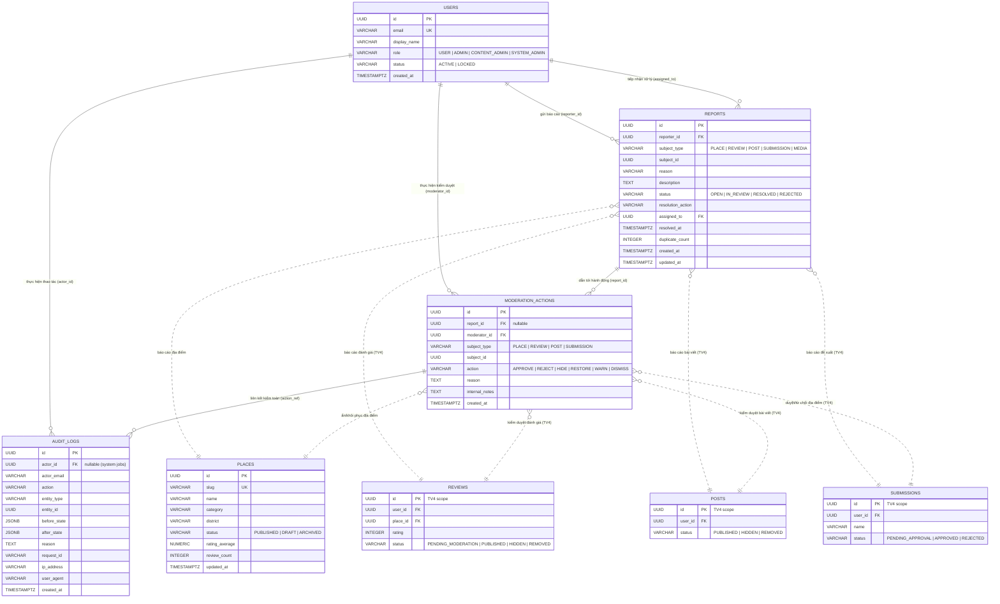

# Thiết Kế Mô Hình Dữ Liệu ERD (Entity Relationship Diagram)
## Phân hệ Quản Trị, Kiểm Duyệt & Báo Cáo — TV5

---

## 1. Sơ đồ thực thể quan hệ (Mermaid ERD)

Dưới đây là sơ đồ quan hệ giữa các bảng hiện có của hệ thống (`users`, `places`), các bảng do TV5 thiết kế mới (`reports`, `moderation_actions`, `audit_logs`), và các thực thể tương lai của TV4 (`reviews`, `submissions`, `posts`):



---

## 2. Phân tích thiết kế khóa tham chiếu đa hình (Polymorphic References)

Trong hệ thống DNVIBE, cả `reports` và `moderation_actions` đều phải tham chiếu đến nhiều loại thực thể khác nhau: `Place`, `Review`, `Post`, `Submission`, `Media`.

Trong cơ sở dữ liệu quan hệ PostgreSQL, có 3 phương án thiết kế chính:

| Tiêu chí | Phương án A: Polymorphic Type + ID (`subject_type`, `subject_id`) | Phương án B: Multiple Nullable Foreign Keys (`place_id`, `review_id`, `post_id`...) | Phương án C: Base Entity Table (`entities` table kế thừa) |
|---|---|---|---|
| **Độ phức tạp schema** | **Thấp, linh hoạt cao** | Trung bình, nhiều cột `NULL` | Rất cao, tăng số lượt `JOIN` |
| **Tính toàn vẹn tham chiếu (RDBMS FK)** | Không thể khai báo constraint `REFERENCES` vật lý | Có thể dùng `FOREIGN KEY` trực tiếp | Có thể dùng `FOREIGN KEY` trực tiếp |
| **Khả năng mở rộng (Extensibility)** | **Tuyệt vời** (thêm loại nội dung mới không cần `ALTER TABLE`) | Kém (mỗi khi thêm loại entity phải thêm cột mới) | Khá tốt nhưng cồng kềnh |
| **Độ phù hợp với hiện trạng dự án** | **Rất cao (Được chọn)** vì các bảng TV4 (`reviews`, `posts`, `submissions`) **chưa tồn tại** trong DB lúc này | Kém vì không thể tạo `REFERENCES` đến bảng chưa có | Kém, làm phức tạp hoá kiến trúc MVP |

### Quyết định kiến trúc của TV5:
1. Áp dụng **Phương án A (Polymorphic Pattern)**: Sử dụng cặp cột `subject_type VARCHAR(50)` và `subject_id UUID`.
2. Bảo vệ toàn vẹn dữ liệu ở tầng **Service / Domain Layer** thông qua pattern Factory / Adapter (`SubjectResolverService`). Khi TV4 hoàn thành bảng nào, Service sẽ kích hoạt xác thực kiểm tra tồn tại tương ứng.
3. Đánh index phức hợp `(subject_type, subject_id)` để tối ưu hóa tốc độ truy vấn lịch sử kiểm duyệt theo từng đối tượng cụ thể.

---

## 3. Đặc tả chi tiết các bảng do TV5 phụ trách

### 3.1 Bảng `reports` (Báo cáo vi phạm từ người dùng)

* **Mục đích:** Lưu trữ các yêu cầu báo cáo vi phạm, khiếu nại chất lượng nội dung hoặc địa điểm từ phía cộng đồng.
* **Cấu trúc trường:**

| Tên cột | Kiểu dữ liệu | Ràng buộc | Mặc định | Mô tả |
|---|---|---|---|---|
| `id` | UUID | PRIMARY KEY | `gen_random_uuid()` | Khóa chính |
| `reporter_id` | UUID | NOT NULL, FK -> `users(id)` | None | Người gửi báo cáo |
| `subject_type` | VARCHAR(50) | NOT NULL, CHECK in ('PLACE', 'REVIEW', 'POST', 'SUBMISSION', 'MEDIA') | None | Loại đối tượng bị báo cáo |
| `subject_id` | UUID | NOT NULL | None | ID đối tượng bị báo cáo |
| `reason` | VARCHAR(100) | NOT NULL | None | Lý do báo cáo (SPAM, HARASSMENT, INAPPROPRIATE, MISINFORMATION, CLOSED_DOWN...) |
| `description` | TEXT | NULL | None | Chi tiết phản ánh bổ sung |
| `evidence_urls` | VARCHAR(1000) | NULL | None | Đường dẫn ảnh/video chứng cứ (nếu có) |
| `status` | VARCHAR(30) | NOT NULL, CHECK in ('OPEN', 'IN_REVIEW', 'RESOLVED', 'REJECTED') | `'OPEN'` | Trạng thái xử lý báo cáo |
| `resolution_action` | VARCHAR(50) | NULL | None | Hành động giải quyết (CONTENT_HIDDEN, WARNED, REJECTED_NO_VIOLATION...) |
| `assigned_to` | UUID | NULL, FK -> `users(id)` | None | Moderator nhận xử lý |
| `resolved_at` | TIMESTAMPTZ | NULL | None | Thời điểm hoàn tất xử lý |
| `duplicate_count` | INTEGER | NOT NULL | 1 | Số lần báo cáo trùng lặp đã gộp (BR-60) |
| `created_at` | TIMESTAMPTZ | NOT NULL | `CURRENT_TIMESTAMP` | Thời điểm tạo |
| `updated_at` | TIMESTAMPTZ | NOT NULL | `CURRENT_TIMESTAMP` | Thời điểm cập nhật cuối |

* **Chỉ mục (Indexes):**
  * `idx_reports_status`: Phục vụ lọc hàng đợi báo cáo (`OPEN`, `IN_REVIEW`).
  * `idx_reports_subject`: `(subject_type, subject_id)` phục vụ tìm tất cả report của 1 đối tượng.
  * `idx_reports_reporter_created`: `(reporter_id, created_at DESC)` phục vụ kiểm tra rate-limit và deduplication (BR-60).

---

### 3.2 Bảng `moderation_actions` (Phiên quyết định kiểm duyệt)

* **Mục đích:** Ghi nhận chính thức quyết định của Moderator đối với một nội dung cụ thể, liên kết với Report hoặc kiểm duyệt chủ động.
* **Cấu trúc trường:**

| Tên cột | Kiểu dữ liệu | Ràng buộc | Mặc định | Mô tả |
|---|---|---|---|---|
| `id` | UUID | PRIMARY KEY | `gen_random_uuid()` | Khóa chính |
| `report_id` | UUID | NULL, FK -> `reports(id)` ON DELETE SET NULL | None | Báo cáo khởi phát (nếu có) |
| `moderator_id` | UUID | NOT NULL, FK -> `users(id)` | None | Người thực hiện kiểm duyệt |
| `subject_type` | VARCHAR(50) | NOT NULL, CHECK in ('PLACE', 'REVIEW', 'POST', 'SUBMISSION') | None | Loại nội dung |
| `subject_id` | UUID | NOT NULL | None | ID nội dung |
| `action` | VARCHAR(50) | NOT NULL, CHECK in ('APPROVE', 'REJECT', 'HIDE', 'RESTORE', 'WARN', 'DISMISS') | None | Hành động can thiệp |
| `reason` | TEXT | NOT NULL | None | Lý do bắt buộc (BR-142) |
| `internal_notes` | TEXT | NULL | None | Ghi chú nội bộ cho ban quản trị |
| `created_at` | TIMESTAMPTZ | NOT NULL | `CURRENT_TIMESTAMP` | Thời điểm thực hiện |

* **Chỉ mục (Indexes):**
  * `idx_mod_actions_subject`: `(subject_type, subject_id)` tra cứu lịch sử kiểm duyệt của nội dung.
  * `idx_mod_actions_moderator`: `(moderator_id, created_at DESC)` thống kê hiệu suất kiểm duyệt viên.

---

### 3.3 Bảng `audit_logs` (Nhật ký kiểm toán hệ thống bất biến)

* **Mục đích:** Ghi lại mọi biến động dữ liệu nhạy cảm do Admin/Moderator thực hiện, phục vụ thanh tra an ninh.
* **Cấu trúc trường:**

| Tên cột | Kiểu dữ liệu | Ràng buộc | Mặc định | Mô tả |
|---|---|---|---|---|
| `id` | UUID | PRIMARY KEY | `gen_random_uuid()` | Khóa chính |
| `actor_id` | UUID | NULL, FK -> `users(id)` ON DELETE SET NULL | None | Người thao tác (NULL nếu hệ thống tự chạy) |
| `actor_email` | VARCHAR(255) | NOT NULL | None | Email lưu tại thời điểm thao tác |
| `action` | VARCHAR(60) | NOT NULL | None | Tên hành động quản trị |
| `entity_type` | VARCHAR(50) | NOT NULL | None | Tên thực thể (`USER`, `PLACE`, `REVIEW`, `REPORT`...) |
| `entity_id` | UUID | NOT NULL | None | ID của thực thể bị thay đổi |
| `before_state` | JSONB | NULL | None | Snapshot dữ liệu trước thay đổi |
| `after_state` | JSONB | NOT NULL | None | Snapshot dữ liệu sau thay đổi |
| `reason` | TEXT | NOT NULL | None | Lý do thực hiện |
| `request_id` | VARCHAR(64) | NULL | None | Correlation ID liên kết log kỹ thuật |
| `ip_address` | VARCHAR(45) | NULL | None | Địa chỉ IP máy trạm |
| `user_agent` | VARCHAR(255) | NULL | None | Thiết bị thực hiện |
| `created_at` | TIMESTAMPTZ | NOT NULL | `CURRENT_TIMESTAMP` | Thời điểm ghi log |

* **Chỉ mục (Indexes):**
  * `idx_audit_logs_actor`: `(actor_id, created_at DESC)` lọc log theo người thực hiện.
  * `idx_audit_logs_entity`: `(entity_type, entity_id, created_at DESC)` truy vết lịch sử một đối tượng.
  * `idx_audit_logs_created_at`: `(created_at DESC)` phân trang danh sách log gần nhất.

---

## 4. Bản dự thảo SQL DDL (Proposal cho Tuần 2)

> ⚠️ **LƯU Ý:** Đoạn script dưới đây là bản **ĐỀ XUẤT (RFC)** để toàn đội ngũ thống nhất. File migration chính thức sẽ được tạo ở Tuần 2 theo đúng thứ tự Flyway của dự án, hoàn toàn không chạy đè lên cơ sở dữ liệu hiện tại trong Tuần 1.

```sql
-- PROPOSAL: Migration V7__create_moderation_report_audit_tables.sql
-- Subsystem: Moderation, Report & Admin (TV5)

CREATE TABLE IF NOT EXISTS reports (
    id UUID PRIMARY KEY DEFAULT gen_random_uuid(),
    reporter_id UUID NOT NULL REFERENCES users(id) ON DELETE RESTRICT,
    subject_type VARCHAR(50) NOT NULL,
    subject_id UUID NOT NULL,
    reason VARCHAR(100) NOT NULL,
    description TEXT,
    evidence_urls VARCHAR(1000),
    status VARCHAR(30) NOT NULL DEFAULT 'OPEN',
    resolution_action VARCHAR(50),
    assigned_to UUID REFERENCES users(id) ON DELETE SET NULL,
    resolved_at TIMESTAMPTZ,
    duplicate_count INTEGER NOT NULL DEFAULT 1,
    created_at TIMESTAMPTZ NOT NULL DEFAULT CURRENT_TIMESTAMP,
    updated_at TIMESTAMPTZ NOT NULL DEFAULT CURRENT_TIMESTAMP,
    CONSTRAINT chk_reports_subject_type CHECK (subject_type IN ('PLACE', 'REVIEW', 'POST', 'SUBMISSION', 'MEDIA')),
    CONSTRAINT chk_reports_status CHECK (status IN ('OPEN', 'IN_REVIEW', 'RESOLVED', 'REJECTED')),
    CONSTRAINT chk_reports_duplicate_count CHECK (duplicate_count >= 1)
);

CREATE INDEX IF NOT EXISTS idx_reports_status ON reports (status);
CREATE INDEX IF NOT EXISTS idx_reports_subject ON reports (subject_type, subject_id);
CREATE INDEX IF NOT EXISTS idx_reports_reporter_created ON reports (reporter_id, created_at DESC);
CREATE INDEX IF NOT EXISTS idx_reports_assigned_to ON reports (assigned_to);

CREATE TABLE IF NOT EXISTS moderation_actions (
    id UUID PRIMARY KEY DEFAULT gen_random_uuid(),
    report_id UUID REFERENCES reports(id) ON DELETE SET NULL,
    moderator_id UUID NOT NULL REFERENCES users(id) ON DELETE RESTRICT,
    subject_type VARCHAR(50) NOT NULL,
    subject_id UUID NOT NULL,
    action VARCHAR(50) NOT NULL,
    reason TEXT NOT NULL,
    internal_notes TEXT,
    created_at TIMESTAMPTZ NOT NULL DEFAULT CURRENT_TIMESTAMP,
    CONSTRAINT chk_mod_actions_subject_type CHECK (subject_type IN ('PLACE', 'REVIEW', 'POST', 'SUBMISSION')),
    CONSTRAINT chk_mod_actions_action CHECK (action IN ('APPROVE', 'REJECT', 'HIDE', 'RESTORE', 'WARN', 'DISMISS'))
);

CREATE INDEX IF NOT EXISTS idx_mod_actions_subject ON moderation_actions (subject_type, subject_id);
CREATE INDEX IF NOT EXISTS idx_mod_actions_moderator ON moderation_actions (moderator_id, created_at DESC);

CREATE TABLE IF NOT EXISTS audit_logs (
    id UUID PRIMARY KEY DEFAULT gen_random_uuid(),
    actor_id UUID REFERENCES users(id) ON DELETE SET NULL,
    actor_email VARCHAR(255) NOT NULL,
    action VARCHAR(60) NOT NULL,
    entity_type VARCHAR(50) NOT NULL,
    entity_id UUID NOT NULL,
    before_state JSONB,
    after_state JSONB NOT NULL,
    reason TEXT NOT NULL,
    request_id VARCHAR(64),
    ip_address VARCHAR(45),
    user_agent VARCHAR(255),
    created_at TIMESTAMPTZ NOT NULL DEFAULT CURRENT_TIMESTAMP
);

CREATE INDEX IF NOT EXISTS idx_audit_logs_actor ON audit_logs (actor_id, created_at DESC);
CREATE INDEX IF NOT EXISTS idx_audit_logs_entity ON audit_logs (entity_type, entity_id, created_at DESC);
CREATE INDEX IF NOT EXISTS idx_audit_logs_created_at ON audit_logs (created_at DESC);
```
