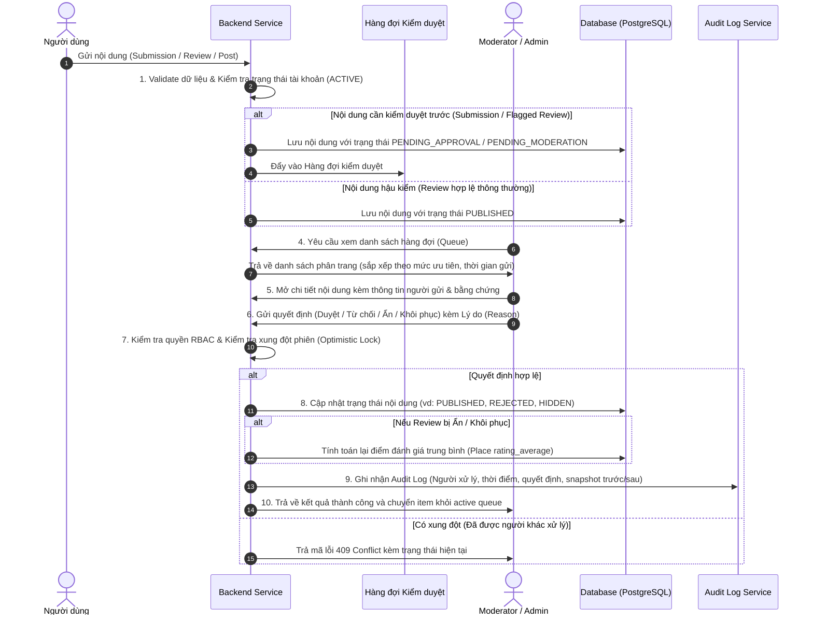
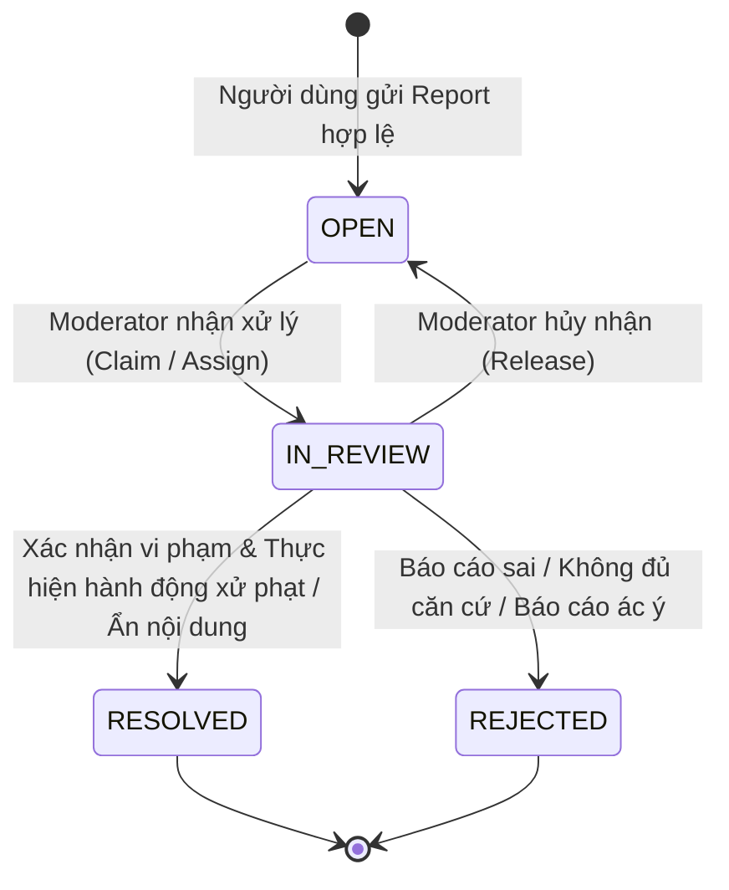

# Đặc Tả Luồng Nghiệp Vụ: Moderation, Report & Nhật Ký Xử Lý (Audit Log)
## Phân hệ Quản Trị & Kiểm Duyệt — TV5

---

## 1. Phân biệt các khái niệm trạng thái trong hệ thống

Một trong những sai lầm phổ biến trong kiến trúc kiểm duyệt là gộp chung trạng thái của nội dung, trạng thái của báo cáo và lịch sử xử lý vào một trường duy nhất. Kiến trúc DNVIBE / CITYPULSE phân định rạch ròi 4 tầng trạng thái độc lập:

```
+---------------------------------------------------------------------------------------+
|  1. Trạng thái nội dung nghiệp vụ (Content Status)                                    |
|     - Place: DRAFT -> PUBLISHED -> ARCHIVED (có cờ needs_review)                      |
|     - Review / Post: PENDING_MODERATION -> PUBLISHED -> HIDDEN / REMOVED               |
|     - Submission: PENDING_APPROVAL -> APPROVED / REJECTED                             |
+---------------------------------------------------------------------------------------+
|  2. Trạng thái báo cáo vi phạm (User Report Status)                                   |
|     - Report: OPEN -> IN_REVIEW -> RESOLVED / REJECTED                                |
+---------------------------------------------------------------------------------------+
|  3. Phiên hành động kiểm duyệt (Moderation Action)                                    |
|     - Action Type: APPROVE, REJECT, HIDE, RESTORE, WARN, DISMISS                      |
|     - Ghi nhận quyết định của Moderator/Admin tại thời điểm can thiệp                |
+---------------------------------------------------------------------------------------+
|  4. Nhật ký kiểm toán bất biến (System & Administrative Audit Log)                   |
|     - Snapshot thay đổi: actor_id, entity_type, entity_id, before_state, after_state  |
|     - Append-only, không thể chỉnh sửa hay xóa qua API nghiệp vụ                      |
+---------------------------------------------------------------------------------------+
```

---

## 2. Quy trình kiểm duyệt nội dung (Content Moderation Workflow)

Hệ thống xử lý 4 loại nội dung trọng yếu:
1. **Submission (Đề xuất địa điểm từ người dùng/đối tác):** Phải qua tiền kiểm duyệt trước khi được chuyển thành địa điểm chính thức.
2. **Review (Đánh giá & chấm điểm địa điểm):** Mặc định công khai ngay (hậu kiểm duyệt) hoặc tiền kiểm nếu bị gắn cờ từ cấm/spam bởi bộ lọc tự động.
3. **Post (Bài viết cộng đồng / Lịch trình chia sẻ):** Hậu kiểm duyệt dựa trên tín hiệu báo cáo người dùng.
4. **Place (Địa điểm chính thức):** Do Content Admin quản lý; có thể bị ẩn (`ARCHIVED` hoặc gắn cờ `needs_review`) khi có phản ánh dữ liệu sai lệch hoặc đóng cửa vĩnh viễn.

### 2.1 Chi tiết luồng 10 bước chuẩn kiến trúc



### 2.2 Các quy tắc nghiệp vụ kiểm duyệt cốt lõi
* **BR-MOD-01 (Chặn tự phê duyệt):** Người gửi nội dung (kể cả có quyền Moderator) không được tự phê duyệt Submission hoặc giải quyết Report nhắm vào nội dung của chính mình.
* **BR-MOD-02 (Bảo vệ nội dung bị ẩn):** Nội dung có trạng thái `HIDDEN`, `REJECTED`, `ARCHIVED` hoặc `PENDING_APPROVAL` tuyệt đối bị loại khỏi các truy vấn công khai (Discover, Search, Map, Place Detail).
* **BR-MOD-03 (Tái tính toán Rating):** Khi một Review bị `HIDE`, điểm số của nó bị trừ khỏi tổng và số lượng review của địa điểm. Khi được `RESTORE`, hệ thống phải cộng lại điểm và cập nhật `rating_average`, `review_count` của bảng `places` (BR-41, BR-59).
* **BR-MOD-04 (Bắt buộc lý do):** Mọi hành động từ chối (`REJECT`) hoặc ẩn nội dung (`HIDE`) bắt buộc phải có trường `reason` tối thiểu 10 ký tự để minh bạch hóa quyết định quản trị (BR-142).

---

## 3. Quy trình xử lý báo cáo vi phạm (User Report Workflow)

Quy trình báo cáo giúp cộng đồng người dùng phản ánh nội dung không phù hợp, thông tin địa điểm sai lệch hoặc hành vi quấy rối.

### 3.1 Vòng đời của Báo cáo (Report Lifecycle)



### 3.2 Các quy tắc nghiệp vụ Report cốt lõi

1. **BR-REP-01 (Báo cáo không tự động xóa nội dung — BR-56):** Việc người dùng gửi báo cáo không bao giờ tự động làm ẩn hay xóa nội dung mục tiêu. Trạng thái nội dung chỉ thay đổi khi Moderator/Admin ra quyết định kiểm duyệt có thẩm quyền.
2. **BR-REP-02 (Chống spam báo cáo & Deduplication — BR-60):**
   * Nếu cùng một `reporter_id` gửi báo cáo cho cùng một `subject_id` và cùng `reason` trong khoảng thời gian cửa sổ ngắn (ví dụ: 60 phút), hệ thống sẽ từ chối với mã lỗi `429 Too Many Requests` hoặc cập nhật tăng biến đếm `duplicate_count` thay vì tạo record rác mới.
   * Nếu nhiều người dùng khác nhau cùng báo cáo một đối tượng, hệ thống gom nhóm theo `subject_id`, tăng chỉ số cảnh báo `report_count` để ưu tiên đẩy lên đầu hàng đợi kiểm duyệt (High Priority Queue).
3. **BR-REP-03 (Đóng báo cáo không có căn cứ):** Khi kiểm tra thấy nội dung không vi phạm quy tắc cộng đồng, Moderator chọn `REJECT` (Bác bỏ báo cáo) kèm lý do giải thích. Trạng thái nội dung mục tiêu được giữ nguyên và đóng báo cáo mà không ảnh hưởng tới người tạo nội dung.
4. **BR-REP-04 (Xử lý đồng thời / Concurrency Control):** Khi 2 Moderator cùng mở xem một báo cáo:
   * Hệ thống áp dụng cơ chế khóa mềm `in_review_by` và trường `version` (Optimistic Locking).
   * Người nhấn xử lý đầu tiên sẽ cập nhật thành công. Người thứ hai gửi request sẽ nhận thông báo lỗi `409 Conflict: Report is already being processed or resolved by another administrator`.

---

## 4. Kiến trúc Nhật ký kiểm toán bất biến (Audit Log Design)

Nhật ký kiểm toán là nền tảng bảo mật của hệ thống quản trị, phục vụ việc truy vết sai phạm, đối soát trách nhiệm và tuân thủ các quy định bảo vệ dữ liệu.

### 4.1 Phạm vi ghi nhận Audit Log
Hệ thống ghi log bắt buộc đối với các hành động mang tính quản trị và thay đổi trạng thái nhạy cảm:
* `ADMIN_USER_LOCK` / `ADMIN_USER_UNLOCK`: Khóa/mở khóa tài khoản người dùng (UC-28).
* `ADMIN_USER_ROLE_CHANGE`: Nâng/hạ quyền hạn tài khoản.
* `MODERATE_SUBMISSION_APPROVE` / `MODERATE_SUBMISSION_REJECT`: Duyệt/từ chối địa điểm đề xuất.
* `MODERATE_REVIEW_HIDE` / `MODERATE_REVIEW_RESTORE`: Ẩn/khôi phục đánh giá địa điểm.
* `MODERATE_POST_HIDE` / `MODERATE_POST_RESTORE`: Ẩn/khôi phục bài viết cộng đồng.
* `MODERATE_PLACE_EDIT` / `MODERATE_PLACE_ARCHIVE` / `MODERATE_PLACE_RESTORE`: Can thiệp trực tiếp địa điểm chính thức (UC-23).
* `REPORT_RESOLVE` / `REPORT_REJECT`: Quyết định xử lý báo cáo vi phạm.

### 4.2 Các trường thông tin trong một bản ghi Audit Log

| Tên trường | Kiểu dữ liệu | Bắt buộc | Mục đích & Ràng buộc |
|---|---|:---:|---|
| `id` | UUID | Có | Khóa chính tự sinh (`gen_random_uuid()`) |
| `actor_id` | UUID | Có | ID của Admin/Moderator thực hiện hành động |
| `actor_email` | VARCHAR(255) | Có | Email người thực hiện tại thời điểm hành động (tránh mất vết khi user bị xóa) |
| `action` | VARCHAR(50) | Có | Mã định danh hành động (vd: `MODERATE_REVIEW_HIDE`) |
| `entity_type` | VARCHAR(50) | Có | Thực thể bị tác động (`USER`, `PLACE`, `REVIEW`, `POST`, `REPORT`) |
| `entity_id` | UUID | Có | ID của bản ghi bị tác động |
| `before_state` | JSONB | Không | Snapshot trạng thái trước khi thay đổi (chỉ lưu các trường nghiệp vụ) |
| `after_state` | JSONB | Có | Snapshot trạng thái sau khi thay đổi |
| `reason` | TEXT | Có | Lý do can thiệp do Admin/Moderator nhập |
| `request_id` | VARCHAR(64) | Có | Tracing ID từ HTTP Header để liên kết với log kỹ thuật |
| `ip_address` | VARCHAR(45) | Có | Địa chỉ IP của Client thực hiện yêu cầu |
| `user_agent` | VARCHAR(255) | Không | Trình duyệt / Thiết bị gửi yêu cầu |
| `created_at` | TIMESTAMPTZ | Có | Thời điểm ghi nhận (mặc định `CURRENT_TIMESTAMP`) |

### 4.3 Các nguyên tắc an ninh dữ liệu trong Audit Log (BR-166, BR-148)
1. **Append-Only (Bất biến):** Bảng `audit_logs` chỉ hỗ trợ lệnh `INSERT`. Không cung cấp bất kỳ API nghiệp vụ hay quyền truy cập DB nào cho phép thực thi lệnh `UPDATE` hoặc `DELETE` trên bảng này.
2. **Không lưu dữ liệu nhạy cảm (Sanitization & Masking):**
   * Tuyệt đối không lưu mật khẩu, password hash, JWT token, Authorization Header vào `before_state` hoặc `after_state`.
   * Tuyệt đối không lưu tọa độ GPS thời gian thực (raw exact live coordinates) của người dùng thông thường vào audit log để bảo đảm quyền riêng tư vị trí (BR-09, BR-10).
3. **Phân biệt Audit Log nghiệp vụ và Log kỹ thuật:**
   * **Audit Log nghiệp vụ:** Lưu vào cơ sở dữ liệu PostgreSQL (bảng `audit_logs`), có cấu trúc bảng, phục vụ tra cứu lịch sử hành động của con người trên UI Admin.
   * **Log kỹ thuật (Application Logs):** Ghi qua SLF4J / Logback (Console / File / ELK stack), chứa stacktrace, query latency, connection pool metrics, và liên kết với nhau qua `request_id`.
